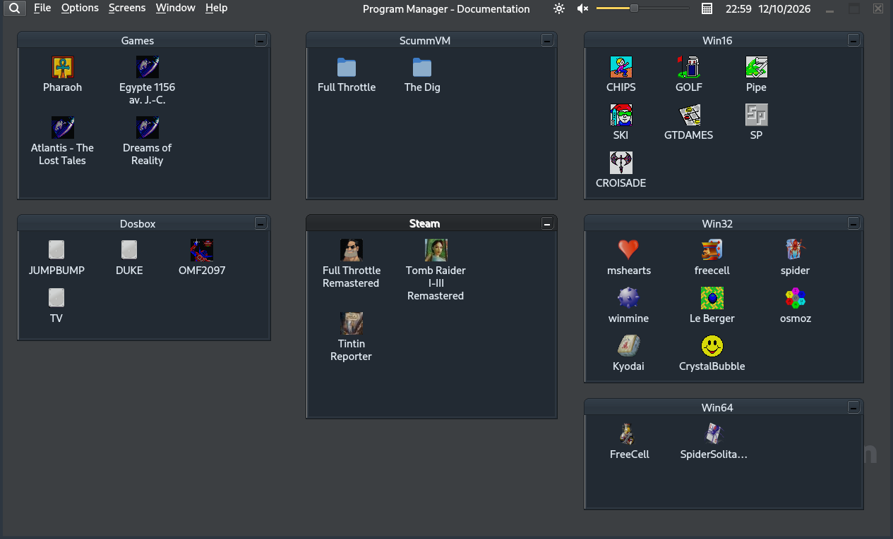
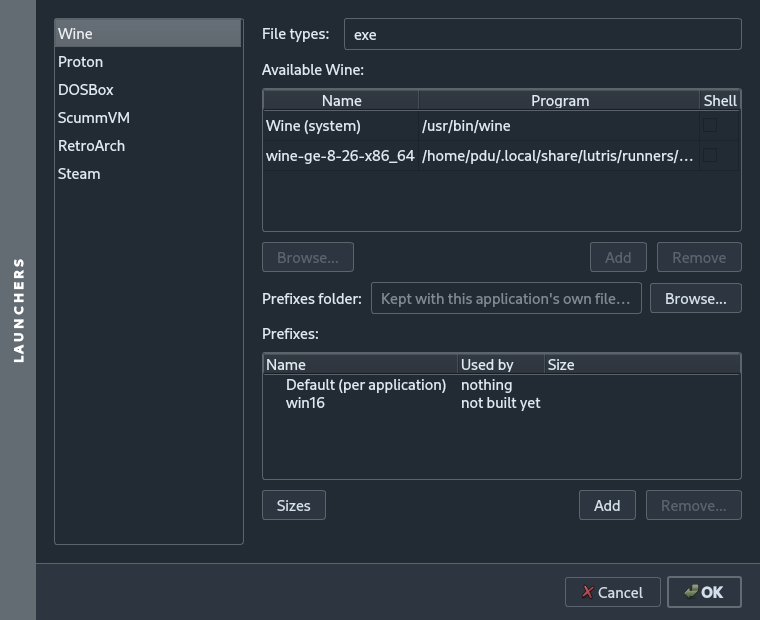
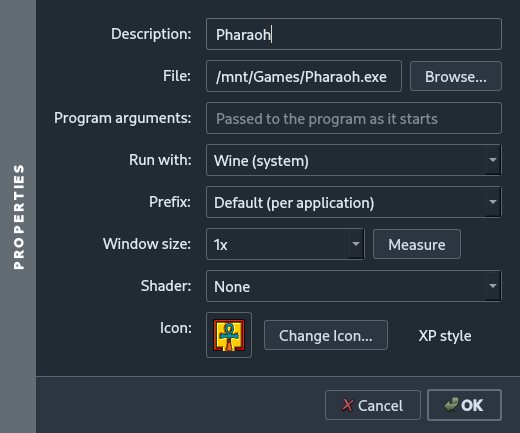
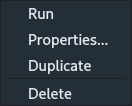
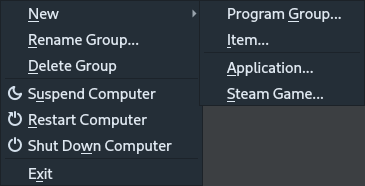
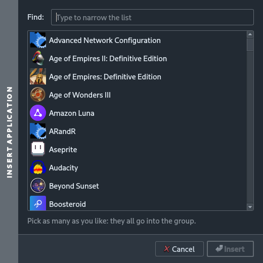
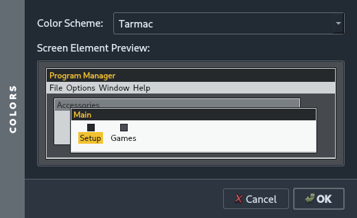
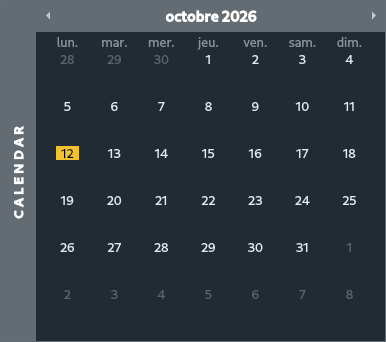
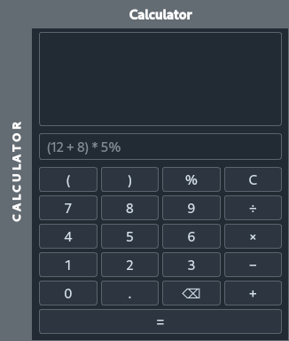
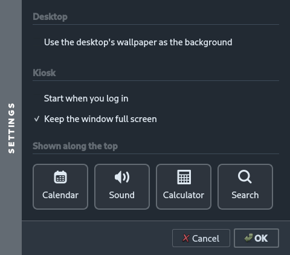

# PMane-Sans-Ame

Font Sans Serif ? No, Program Manager Sans Âme here.

It's another Program Manager Sans-Ame for Linux with program groups full of icons, and a
double click runs what is behind one — a Windows game through Wine or Proton, a
DOS game through DOSBox, a Steam game, a RetroArch stuff or an ordinary Linux application.



---

## The main points of it

- Drag and Drop to add new programs

- It displays Win16, Win32 or Win64 icons for old programs. And it is possible to change icons by looking at exe or dll files like we used to.

- Separated screens, one for Kids for instance, that is started at launch

- Quick version made mostly by IA, without any soul as I wanted to quickly launch my old `GotoDames.exe` with a cute icon.

## What it runs

An item holds a file and the launcher that opens it. Which launchers exist, and
what each one is given to work with, is the **Options ▸ Launchers** dialog:

| Launcher | For |
| --- | --- |
| **Wine** | `.exe` — the system wine, with a prefix per program or a named prefix shared between them |
| **Proton** | `.exe` — any Proton build dropped into Steam's `compatibilitytools.d` |
| **DOSBox** | `.conf` |
| **ScummVM** | `.trs` |
| **RetroArch** | ROMs, with a libretro core picked per file extension |
| **Steam** | games read out of the installed Steam libraries |



Prefixes are listed with what still uses them, so one can be thrown away without
guessing: a prefix no item on any screen leads to is the only kind called unused.

## An item



* **Run with** — any of the launchers above, or nothing, to run the file itself.
* **Prefix** — a Windows install of its own, or one shared by name.
* **Window size** — a program written for a 640×480 screen is run inside
  `gamescope`, which renders it at its own size and scales the picture out. The
  size can be measured from the program rather than typed. Needs gamescope
  installed; without it the row says so.
* **Shader** — a ReShade effect, for anyone who wants a CRT on a flat panel.
* **Icon** — taken out of the executable itself (16-bit and 32-bit PE resources
  both), or picked from a file; **XP style** gives it the raised look.

Right-clicking an item offers the same, plus Run, Duplicate and Delete:



## Filling a group



**File ▸ New** adds a group, a hand-written item, an installed Linux application,
or a Steam game. The application picker searches everything with a `.desktop`
file and inserts as many as you tick:



Files can also be dropped onto a group straight from a file manager; the
launcher is worked out from the extension.

## Screens

It allows to define several screens, the last one opened will be opened at startup

## Looks

Twelve colour schemes — Harbour, Vellum, Orchard, Cobalt, Rhubarb, Tarmac,
Ochre, Lupin, Lacquer, Glacier, Graphite and Sherbet — each with a dark half
worked out from its own colours rather than picked separately.



## The strip along the top

A clock that drops open into a month, a volume slider, a calculator, and a
magnifier that hands the search over to the desktop shell. Each one can be
turned off.





The Program Manager is also a GNOME Shell search provider: typing a program's
name into the shell's own search finds the items in your groups, icons and all.

## Kiosk



For a machine that boots straight into it — a cabinet, a television in the
corner, a cupboard PC — the window is held full screen with no way out of it, and
it can start itself when the session does. Turning the lock off makes it an
ordinary window again.

---

## Building

Qt 6.4 or newer (Widgets, Network, DBus; Svg is optional but wanted — without it
SVG icons and wallpapers draw nothing).

```sh
cmake -B build
cmake --build build -j$(nproc)
./build/pmane-sansame
```

Install, or build a Debian package:

```sh
sudo cmake --install build
cmake --build build --target deb      # build/pmane-sansame_<version>_amd64.deb
```

The package installs the program, its `.desktop` file and the search provider's
`.ini`. Nothing it launches is a dependency: `wine`, `gamescope`, `steam`,
`dosbox`, `scummvm` and `retroarch` are recommended or suggested, and an item
whose launcher is not installed simply says so.

## Running

```
pmane-sansame [--screen <name>] [--configPath <dir>]
```

One instance per user: starting a second one raises the first, switching screen
on the way if one was asked for.

Settings live in `~/.config/pmane-sansame/`: `screens.ini` indexes them and
each screen is an `.ini` of its own.

`--configPath` keeps that lot in a directory of your own instead, and opens as
an instance of its own so it can sit beside the Program Manager already
running. [docs/](docs/) is one such directory — the desktop the pictures above
are taken of, which is how they are retaken:

```sh
./build/pmane-sansame --configPath docs
```

Screens there behave as they always do, so **Screens ▸ New** writes another
`.ini` beside [docs/documentation.ini](docs/documentation.ini), ready to be
committed.
